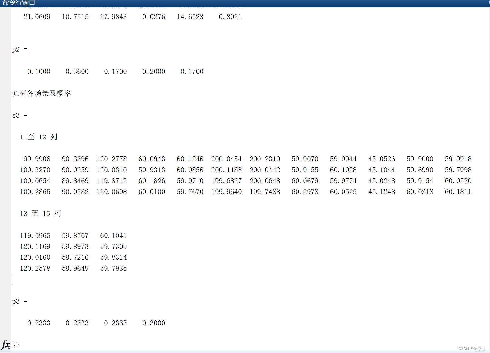

# Wind, solar and load output scenarios with probability, scenario reduction and load points Latin hypercube sampling (Matlab code implementation)

​  
📚2 Results of wind power output in various scenarios and probabilities\n\ns1 =\n\n   22.1083   19.8952    8.1786   10.9965   20.8133   18.8998\n    4.0167   30.0000    4.8795   19.9553   16.5858    6.2363\n    0.6114    8.2198   30.0000   22.9942   10.7087   20.2097\n   30.0000   20.3710   30.0000   23.7236    4.6623   22.2630\n   30.0000   23.7690   18.2472    4.5671    9.2437    6.6501\n\n\np1 =\n\n    0.2800    0.1300    0.2500    0.1200    0.2200\n\nPhotovoltaic output power scenarios and probabilities\n\ns2 =\n\n   21.7371    5.0435    2.6876   16.4512   15.6527    4.9094\n   11.8630   24.0627    7.6918    9.2009   11.0766   10.2721\n    9.8955   11.0822   12.1945   15.9150   26.4814   25.0274\n   11.3307    3.7676   17.0451   14.4192    2.4652   23.9298\n   21.0609   10.7515   27.9343    0.0276   14.6523    0.3021\n\n\np2 =\n\n    0.1000    0.3600    0.1700    0.2000    0.1700\n\nLoad scenarios and probabilities\n\ns3 =\n\n  1 To 12 List\n\n   99.9906   90.3396  120.2778   60.0943   60.1246  200.0454  200.2310   59.9070   59.9944   45.0526   59.9000   59.9918\n  100.3270   90.0259  120.0310   59.9313   60.0856  200.1188  200.0442   59.9155   60.1028   45.1044   59.6990   59.7998\n  100.0654   89.8469  119.8712   60.1826   59.9710  199.6827  200.0648   60.0679   59.9774   45.0248   59.9154   60.0520\n  100.2865   90.0782  120.0698   60.0100   59.7670  199.9640  199.7488   60.2978   60.0525   45.1248   60.0318   60.1811\n\n  13 To 15 List\n\n  119.5965   59.8767   60.1041\n  120.1169   59.8973   59.7305\n  120.0160   59.7216   59.8314\n  120.2578   59.9649   59.7935\n\n\np3 =\n\n    0.2333    0.2333    0.2333    0.3000\n\n>> \n  
Editor
Wind power output scenarios and probabilities
s1 =  
22.1083 19.8952  8.1786 10.9965 20.8133 18.8998  
4.0167 30.0000  4.8795 19.9553 16.5858  6.2363  
0.6114  8.2198 30.0000 22.9942 10.7087 20.2097  
30.0000 20.3710 30.0000 23.7236  4.6623 22.2630  
30.0000 23.7690 18.2472  4.5671  9.2437  6.6501  
p1 =  
0.2800  0.1300  0.2500  0.1200  0.2200  
Photovoltaic output scenarios and probabilities
s2 =  
21.7371  5.0435  2.6876 16.4512 15.6527  4.9094  
11.8630 24.0627  7.6918  9.2009 11.0766 10.2721  
9.8955 11.0822 12.1945 15.9150 26.4814 25.0274  
11.3307  3.7676 17.0451 14.4192  2.4652 23.9298  
21.0609 10.7515 27.9343  0.0276 14.6523  0.3021  
p2 =  
0.1000  0.3600  0.1700  0.2000  0.1700  
Load scenarios and probabilities
s3 =  
1 to 12 columns
99.9906 90.3396 120.2778 60.0943 60.1246 200.0454 200.2310 59.9070 59.9944 45.0526 59.9000 59.9918  
100.3270 90.0259 120.0310 59.9313 60.0856 200.1188 200.0442 59.9155 60.1028 45.1044 59.6990 59.7998  
100.0654 89.8469 119.8712 60.1826 59.9710 199.6827 200.0648 60.0679 59.9774 45.0248 59.9154 60.0520  
100.2865 90.0782 120.0698 60.0100 59.7670 199.9640 199.7488 60.2978 60.0525 45.1248 60.0318 60.1811  
13 to 15 columns
119.5965 59.8767 60.1041  
120.1169 59.8973 59.7305  
120.0160 59.7216 59.8314  
120.2578 59.9649 59.7935  
p3 =  
0.2333  0.2333  0.2333  0.3000  
>>  
🎉3 References
[2]Zhe Yang (2022). Improved-Aptenodytes-Forsteri-Optimization-IAFO-Algorithm  
🌈4 Matlab code implementation

## Images

<!-- PAYMENT_BLOCK -->

## Get this dataset

- Payment link (Stripe): [Buy now](https://buy.stripe.com/3cs8yP7sY87d0vu9AB)
- Payment QR code: 

<!-- /PAYMENT_BLOCK -->
